# Architecture

How this toolkit is built and how work flows through it. For install and usage see the [README](README.md).

## 1. What this is and is not

One line: skills, small bash tools and a shared library that make any agent CLI work in the same disciplined, logged, resumable way.

| Is | Is not |
|---|---|
| A workflow and orchestration layer on top of agent CLIs | An agent runtime or a model client |
| Skills (checklists), bash tools, a library, a learning loop | A service, daemon or database |
| Agent-agnostic: Claude Code, Codex and OpenCode all use it | Tied to one vendor |

- The agent CLIs are the runtimes: they run the agent loop and call the models.
- This toolkit never calls a model. It guides the agent, records what happened, and launches other CLIs (interactive in a herdr tab, headless as the fallback).

## 2. Big picture



| Layer | What lives there | Who reads it |
|---|---|---|
| Entry rules | `AGENTS.md` (routes and always-rules, max 6144 B), `CLAUDE.md` | Main agent, every session |
| Skills | `skills/dev-*/SKILL.md`: twelve skills: an entry point (dev-mode), eight routes, each a checklist, and three formal-verification support skills (dev-formal-verification-skill, dev-create-formal-verification-skill, dev-maintain-formal-verification-skill; explicit-only, not routes) | Main agent, one per task |
| Library | `library/`: principles, core, deep, recipes | Main agent or workers, on demand |
| Tools | `bin/`: ledger, state, reconcile, spawn, run, learn, setup, chart-svg, lint-budget | Agents run them; people can too |
| Per-task files | `.devkit/tasks/<id>/` in the project repo, git-ignored | Agents resuming or reviewing a task |
| Learning inbox | `~/.agents/learnings/` (local, outside any repo) | `learn`, then the dev-learn skill |
| Install links | `install.sh` symlinks into each CLI's skills folder | The CLIs |

## 3. Components

All tools are bash. `<task>` means `.devkit/tasks/<id>`. The task comes from `-t <id>` or `DEVKIT_TASK`; with neither, tools exit 2 (no shared fallback).

### 3.1 ledger (`bin/ledger`)
- Purpose: append-only record of every step of one task.
- Commands: `start <slug> [note]` (prints the id), `[-t id] <phase> <decision> <reason> [evidence] [result]`, `done [summary]`, `path`, `base`.
- Owns: `<task>/ledger.tsv`, a `state.md` template, and a line in `.git/info/exclude` that hides `.devkit/`.
- Behaviors:
  - Id is `<slug>-<yymmdd-HHMMSS>-<4 hex>`; the directory is created with atomic `mkdir`, retried on collision.
  - Tabs and newlines in fields become spaces; each field is cut to 400 chars with a warning.
  - `DEVKIT_LEDGER_MIRROR="<cmd>"` runs with the row text as `$1`; `DEVKIT_DIR` overrides the `.devkit` location.
  - `start` refuses inside a worker (`DEVKIT_DEPTH` nonzero); workers log to their own `DEVKIT_TASK`. The refusal status is 3.
  - Inside a git worktree the base resolves to the main repo, so workers share one `.devkit`.

### 3.2 state (`bin/state`)
- Purpose: lint a task's `state.md` and the project's `.devkit/memory.md` against the no-redundancy rules.
- Command: `state check [-t id]`. Exit 0 ok, 1 violations (printed as `FAIL file:line: why`), 2 usage.
- Rules for `state.md`:
  - Exactly five sections, at most 60 lines, no Next section (the ledger `next` row owns it).
  - Direction at most 3 lines; every bullet at most 140 chars.
  - Findings, Decisions and Learnings bullets carry a pointer; no 40-char run copied from a ledger row.
  - No tabs or CRs (they would corrupt the inbox).
- Rules for `memory.md`: at most 80 lines; each bullet has a pointer or a `command`.

### 3.3 reconcile (`bin/reconcile`)
- Purpose: rebuild status from disk and git. No watcher, no state of its own.
- Commands: no args (open tasks, one line each), `--all` (include finished), `<id>` (detail).
- Detail view shows: resume point (last `next` row), direction, open questions, learning counts, last 5 rows, workers, `plan.json` slice count, branches `devkit/<id>-*`.
- A worker whose status says `running` but whose pid is dead is shown as `killed`.
- Footer line `learnings queued: N (run dev-learn)` when the inbox is non-empty.

### 3.4 spawn (`bin/spawn`)
- Purpose: run one sub-agent on any CLI (a herdr tab TUI when herdr is up, else headless), brief in, handoff out. Blocks; the caller backgrounds it.
- Usage: `spawn [--shape ship|scout] [--worktree] [--lead] [--model M] <id> <claude|codex|opencode> <brief-file>`; `--prompt "text"` replaces the brief file (saved to `briefs/<id>.md`).
- Updates file: every worker prompt tells the worker to read `<task>/updates/<id>.md` before each slice and before its handoff, so the main agent changes a running worker's scope by appending a line, with no interrupt and no approval prompt. A cross-session message is for urgent interrupts only; a worker in another permission mode holds it until the user approves it.
- Also: `--doctor` (CLIs installed, adapter flags still valid), `--close-views` (close kept herdr tabs).
- Herdr view: when herdr is up, the tab tails the worker log. The opencode adapter names its session (`ses_dk_*`) and the tab attaches to it with `opencode -s <id>` instead, so the new tab runs the agent; a session that never appears falls back to the log tail.
- Interactive (`DEVKIT_MODE`, default `auto`): with herdr up and a real CLI (claude, codex, opencode; never `fake`, never `DEVKIT_VIEW=off`), the worker is the normal TUI in a herdr tab, so its todo or plan panel shows. Flow: `tab create --env` (depth, task, dir, push-guard pair and set knobs; the pane shell is herdr's, so spawn's exports do not reach it) then `agent start <id> --kind <cli> -- <flags>` then one `agent prompt` line "Read <task>/briefs/<id>.prompt and follow it". No `-p`, `exec` or `run`.
  - Flags: claude `--dangerously-skip-permissions -n <id>`; codex `-C <wd>` plus `-c projects."<dir>".trust_level="trusted"` (repo and worktree) to skip the trust dialog; opencode `--auto -s <sid>`, model through `OPENCODE_CONFIG_CONTENT` in the tab env (the TUI has no `-m`).
  - Done is a handoff ending in `## Checklist` (polled every `DEVKIT_POLL`, then `DEVKIT_GRACE`; with `DEVKIT_IDLE_WAIT=0` any non-empty handoff once the agent stops working), then the tab closes. A failed start, a timeout, a pane gone, or an agent unknown to herdr, for 3 polls with no handoff (`failed`) and a spawn killed by TERM/INT/HUP all write the stub from `herdr pane read`, notify, then close the tab, so no stale tab is left (`DEVKIT_VIEW_KEEP=1` keeps and records it for `--close-views`). A tab that cannot be created while herdr is up is a loud `failed`, never a quiet headless run. Agent state alone is never done; an idle agent only starts the idle guard below.
  - A scout that changes files in a tab is a ledger warning, not `violation` (a person may type there). `DEVKIT_MODE=headless` or herdr down keeps the old path; `interactive` without herdr exits 2.
  - Task list guard: the short `agent prompt` line repeats the checklist instruction ("before any other tool call", naming TaskCreate, TodoWrite, update_plan, todowrite). After `DEVKIT_NUDGE_WAIT` seconds spawn reads the pane; if no task list is drawn it re-sends the instruction once and ledgers a `nudge` row. claude tabs get `CLAUDE_CODE_ENABLE_TODO_TOOLS=1`, without which no task tools exist.
  - Idle guard: done means a handoff ending in `## Checklist`. An agent idle (herdr `idle` or `done`; never `blocked` or `unknown`, so no keystroke lands in a dialog) for `DEVKIT_IDLE_WAIT` seconds without one gets one prompt to finish; idle again for as long, the run fails and keeps any draft handoff.
  - Eval: `evals/spawn-interactive.sh` (manual, costs tokens; `--list` shows the cases; runs from a worker too: it uses its own sandbox DEVKIT_DIR and drops the inherited depth and task) spawns a trivial scout per installed CLI and asserts tab created, agent detected, ticked `## Checklist`, tab closed, exit 0. `tests/spawn-eval.test.sh` checks its scoring with fakes.
  - opencode todo panel: needs `experimental.todo` in the global opencode config (install.sh sets it); `--doctor` warns when it is missing.
- Owns: `<task>/handoffs/<id>.{md,log,last}`, `<task>/briefs/<id>.prompt`, `<task>/run/<id>.{status,timedout,tab,checklist}`, `<task>/run/<id>.claim/`, `<task>/wt/<id>/`, repo-wide `.devkit/run/slot.N/`.

```mermaid
sequenceDiagram
  participant M as Main agent
  participant S as bin/spawn
  participant W as Worker CLI
  participant L as Ledger
  M->>S: spawn id cli brief (background)
  S->>S: claim id (atomic mkdir; a live id exits 2 "already running")
  S->>S: claim slot (per-slot lock around mkdir and the pid write, up to the worker cap)
  S->>S: optional git worktree devkit/task-id
  S->>S: push guard (dead pushurl), build CLI command, status=running
  S->>W: launch (interactive TUI in a herdr tab; headless, stdin closed, log to handoffs/id.log, as the fallback)
  S-->>S: timeout guard (TERM, then KILL after 5 s)
  W->>L: bin/ledger rows for its decisions
  W->>S: writes handoffs/id.md
  S->>S: no handoff? auto-generate one from the log tail
  S->>L: status done, failed, timeout or violation; row: spawn
  S-->>M: exit 0 only if state is done
```

- States: `done`, `failed` (non-zero exit or no handoff), `timeout`, `violation` (a scout changed HEAD, tracked content or untracked files outside `.devkit/`; checked by content hash, so commits and repeat edits count).
- Interrupt (INT, TERM, HUP): spawn stops the worker and its children, closes the herdr tab (or records it under `DEVKIT_VIEW_KEEP`), frees the slot, and writes `killed` to the status and the ledger.
- Failure modes: spawn past the nesting limit (see env table) exits 3; a second spawn of a live id exits 2 with `already running`; bad knob values, unknown CLI, bad id or unreadable brief exits 2; worktree failure exits 1. Timeout or interrupt signals the worker's whole process group (TERM, then KILL); a descendant that calls setsid or setpgrp to leave the group survives. `bin/spawn` re-executes itself from a private copy (`$TMPDIR/dk-spawn.*`, unlinked at start) so editing the script or switching the main checkout's branch mid-run cannot crash a live spawn; the copy reads `bin/defaults` and `bin/ledger` from the original dir. A `kill -9` of spawn runs no cleanup: the slot and the id claim stay counted while the worker lives (both record the worker pid), so a retry cannot start a second worker; once the worker is gone a dead owner's claim and slot are reclaimed.

Defaults live in `bin/defaults` (an env var of the same name overrides it); `tests/defaults.test.sh` keeps this table equal to them.

| Flag or env | Default | Effect |
|---|---|---|
| `--shape` | `ship` | `scout` adds "change NO code" to the prompt and checks the tree after |
| `--worktree` | off | Worker runs in `<task>/wt/<id>` on branch `devkit/<task>-<id>` |
| `--lead` | off | Long-lived lead: implies `--worktree`, writes `run/<id>.detached` and (fresh worktree only) `run/<id>.base`, the commit it started from; holds `run/<id>.lead` while it runs |
| `--model`, `DEVKIT_MODEL` | CLI default | Passed as `--model` (claude) or `-m` |
| `DEVKIT_MAX_WORKERS` | auto | Slot count, repo-wide; auto means min(3 x cores, RAM in GB) within 4..64, or 10 when the machine cannot be read (`DEVKIT_CORES` and `DEVKIT_RAM_GB` override detection, e.g. for a container RAM limit): one pool shared by leads and their helpers, first come first served (no per-lead budget); a nested spawn past the pool waits `DEVKIT_CHILD_WAIT` then exits 4; extras wait, stale slots (dead/reused pid, no pid after 1s) reclaimed under a per-slot lock that names its owner (pid + start; stolen only from a dead or reused owner), with a start-time check against pid reuse; a claim takes that lock before its mkdir and holds it through the pid write, so a stalled claimer's dir is never mistaken for stale |
| `DEVKIT_MAX_LEADS` | auto | Live `--lead` workers, repo-wide; auto means at most half the worker pool and at most 10 (at least 1); a `--lead` spawn past it exits 4 with a message. A lead claims its place (`run/<id>.lead`, owner pid + start) under one repo-wide owner lock before the count, so two simultaneous leads cannot both pass; the claim lives until cleanup and a dead or reused owner is reclaimed, so leads of other tasks count too |
| `DEVKIT_MAX_DEPTH` | 3 | Nesting limit: a worker may spawn until its depth reaches it |
| `DEVKIT_CHILD_WAIT` | 60 | Seconds a nested spawn waits for a slot before exit 4 (its parents hold slots, so waiting forever could deadlock) |
| `DEVKIT_TIMEOUT` | 7200 s | 0 disables; hung worker is TERMed, then KILLed |
| `DEVKIT_STOP_TIMEOUT` | 10 s | Cap on `opencode session delete` at worker exit (at least 1; TERM, then KILL) |
| `DEVKIT_SAFE` | unset | Restricted permissions instead of skipping them |
| `DEVKIT_DRYRUN` | unset | Print the CLI command and exit |
| `DEVKIT_VIEW` | herdr | `off` disables the tab; `DEVKIT_VIEW_KEEP=1` keeps it; `DEVKIT_VIEW_NOTIFY=all` notifies on success |
| `DEVKIT_MODE` | auto | `auto` runs claude, codex and opencode as its interactive TUI in a herdr tab when herdr is up; `headless` forces `-p`; `interactive` fails (exit 2) without herdr |
| `DEVKIT_POLL` | 2 | Seconds between handoff checks in interactive mode |
| `DEVKIT_GRACE` | 10 | Seconds an interactive worker may keep writing after its handoff appears |
| `DEVKIT_NUDGE_WAIT` | 20 | Seconds after launch an interactive worker may go without a task list on screen before spawn re-sends the checklist instruction once (ledgered as `nudge`); 0 disables |
| `DEVKIT_IDLE_WAIT` | 60 | Seconds an interactive worker may sit idle with no final handoff (one ending in `## Checklist`) before spawn nudges it once (ledgered as `nudge`); idle that long again fails the run as `idle without final handoff`; 0 disables and an idle agent with any handoff counts as done |
| `DEVKIT_WAIT` | 100 | Seconds `reconcile --wait` polls before giving up (exit 1); under the Bash tool's 120 s default timeout, so repeat it |
| `DEVKIT_GATE_POLL` | 5 | Seconds between `reconcile --wait` polls |
| `DEVKIT_VIEW_CLOSE_DELAY` | 2 | Seconds a finished worker's tab stays open before it closes |
| `DEVKIT_DEPTH` | parent depth + 1 in workers (main agent is 0) | `spawn` refuses at `DEVKIT_MAX_DEPTH` (exit 3) |

| CLI | Command built | Restricted mode (`DEVKIT_SAFE`) |
|---|---|---|
| claude | `claude -p <prompt> --dangerously-skip-permissions --no-session-persistence` | `--permission-mode acceptEdits --allowedTools Bash Read Edit Write Grep Glob --add-dir <task>` |
| codex | `codex exec -C <dir> --dangerously-bypass-approvals-and-sandbox --skip-git-repo-check --ephemeral -o <task>/handoffs/<id>.last` | `-s workspace-write --add-dir <task>` |
| opencode | `opencode run --auto -s ses_dk_* --title <id> [-m model] <prompt>` | none |

### 3.5 run (`bin/run`)
- Purpose: run a command without flooding context. No agent involved.
- Usage: `run [-n TAIL] <command...>` (default tail 15). Exit code is the command's.
- Output: `exit=<rc> secs=<n> log=<path>`; on failure up to 20 error-looking lines plus the tail.
- Owns: `<task>/runs/NNN.log`; writes a ledger row with phase `run`.

### 3.6 learn (`bin/learn`)
- Purpose: move reusable lessons from a task toward the shared library, with approval.
- Commands: `queue [-t id]`, `list`, `count`, `done <id> promoted|dropped`.
- Owns: `${DEVKIT_LEARN_DIR:-~/.agents/learnings}/inbox.tsv` and `done.tsv`. Append-only, local.
- Behaviors:
  - `queue` takes only open `[ ]` learnings with scope `general` or `recipe`, and flips them to `[~]`.
  - `done` appends an outcome row and flips the task's box to `[x]` or `[-]`.
  - A learning is pending while its inbox row number has no row in `done.tsv`.

### 3.7 lint-budget (`bin/lint-budget`)
- Purpose: keep what agents load small and consistent. `bin/lint-budget [root] [--partial]`.
- Checks:
  - `AGENTS.md` at most 6144 B; 4 to 12 skills, each at most 150 lines, `name` = folder = `dev-*`, one-line description, descriptions total at most 4096 B.
  - Skill sections: When to Use, Checklist, Rationalizations, Red Flags, Verification; a `bin/ledger` mention; a `library/state` reference (except dev-learn).
  - Core library: each file at most 80 lines (sections When to Use, Steps, Red Flags, Verification), total at most 32768 B.
  - Deep: at most 45 lines each, total 65536 B. Recipes: at most 45 lines each, total 49152 B, each indexed.
  - Every `library/...` reference resolves; skill descriptions do not collide (Jaccard 0.5); no home paths, emails or secrets anywhere.

### 3.8 install (`install.sh`)
- Symlinks the repo to `~/.agents/dev-kit` and each `skills/dev-*` into `~/.claude/skills`, `~/.codex/skills` and `~/.agents/skills` (OpenCode and others read the last). Safe to rerun: replaces only symlinks, skips real files.
- With opencode installed or configured, also symlinks `opencode/commands/dev-mode.md` into `~/.config/opencode/commands/dev-mode.md`, so its picker shows one `/dev-mode` command that routes through dev-mode. A leftover `/dev` symlink pointing at this repo is removed on install; real files and other links stay.

### 3.9 Parent Stop gate (`bin/stop-gate`)
- Blocks: a parent Claude session ending its turn while a worker it spawned is running or finished without an `accept` ledger row newer than its last `spawn` row.
- Budget: 3 blocks in a row (under Claude's cap of 8), then fail-open with a stderr warning and a ledger row `gate fail-open`; the counter resets when the gate clears. Anything unexpected also fails open with a stderr line: no executable `ledger` beside the script (symlinked file), malformed input or no `session_id`, a `session_id` outside `A-Za-z0-9_-`, or `reconcile --gate` exiting other than 1. The ledger row goes to every task with outstanding workers.
- Scoping: `bin/spawn` writes `run/<id>.session` from `CLAUDE_CODE_SESSION_ID`; the hook's `session_id` selects only that session's workers.
- Workers of tasks already closed with `done` are not gated, except one that is still running (pid alive): `reconcile --gate --session S` reports it so the Stop hook holds.
- `bin/spawn --lead` writes `run/<id>.detached`: `reconcile --gate` skips that worker while its pid lives, so a long-running lead does not block the parent's turns. `ledger accept "<id> accepted"` for a lead refuses (exit 5) unless its branch `devkit/<task>-<id>` contains the tip of the repo's default branch (`origin/HEAD` when set, else `main`, else `master`; `git merge-base --is-ancestor`); the message says how many commits behind and to rebase, and `rejected` rows are never checked. Once it exits (done, failed, killed, or by the `DEVKIT_TIMEOUT` guard) it needs an `accept` row like any worker; the task line and `reconcile <task>` still show it, but `--gate` and `--wait` skip it while it lives (so `--wait` returns at once; poll the task line to watch a lead), and a respawn without `--lead` removes the marker.
- Claude only; other CLIs rely on spawn's exit row and `bin/reconcile`. Workers are exempt (`DEVKIT_DEPTH` set).
- Wiring: `install.sh` prints the hook snippet; the user merges it into `~/.claude/settings.json`.

### 3.10 worktree prune (`bin/spawn --prune`)
- Removes a task's finished worker worktrees and `devkit/<task>-*` branches: dry run by default (one `<id>  remove|keep  <reason>` line each), `--yes` removes. Removable only when the worker is not running, its worktree is clean, an `accept` ledger row is newer than its `spawn` row, and its branch has no commits ahead of HEAD (`--discard` waives only that last check, for squash or cherry-pick merges).
- `bin/ledger done` warns once on stderr when such branches remain, naming this command; the done row and exit code stay unchanged. Silent when none remain, outside git, or in a worker.

### 3.11 Session default task (`bin/ledger` pointer)
- One pointer file per session at `$(ledger base)/run/session-<sid>.task`, keyed by `CLAUDE_CODE_SESSION_ID`; `ledger start` writes it, `ledger current` reads it.
- Task resolution order: `-t` id, then `DEVKIT_TASK`, then the session pointer, then an error telling the caller to start one.
- Only open tasks resolve; a closed or gone task gives a clear `last task <id> is closed (or gone)` message.
- Workers (`DEVKIT_DEPTH` set) never use the pointer. A session id outside `^[A-Za-z0-9_-]+$` counts as no session.
- Two terminals sharing one session id share one pointer, and the last `start` wins, by design.

### 3.12 Worker isolation guard (`bin/spawn`)
- Prompt rule for `--worktree` workers: edit and commit only inside the own worktree, with relative paths; the main checkout is read-only.
- Before the run, snapshot the main checkout's branch, HEAD, `status --short` and a `diff HEAD` checksum (`.devkit` excluded; a re-edit of an already dirty file shows only in the checksum).
- After the run, a changed snapshot warns on stderr, logs an `isolation-violation` spawn row in the task ledger and appends the warning to the worker handoff; state and exit code stay unchanged.
- When a worker is done, an opencode worker's session is deleted too (best effort), so a finished agent keeps acting nowhere.

### 3.13 setup (`bin/setup`) and chart (`bin/chart-svg`)
- Purpose: check and fix everything the skills need: core tools, agent CLIs, skill links, settings, pinned tools, and repository sync.
- `bin/setup` (environment, links, settings) and `spawn --doctor` (adapter flags) are the two checks; neither replaces the other.
- `--check` (default) is read-only and offline: one `ok|missing|optional|outdated|behind|skipped  name  detail` line per item, then `verdict: ready` or `verdict: N missing`.
- `--apply` prints the check, then makes each fix after one prompt per write: links, bun/tlachart/pele/java/jar, the opencode todo flag, the Claude Stop-gate hook and five allow rows (backup first), and repo pulls with `git pull --ff-only` after one up-front prompt to contact the remotes. A dirty, detached, diverged or no-upstream repo is skipped with a reason; a config repo is report-only, even when it also holds skills.
- `tla2tools.jar` comes from the release pinned in `library/setup.pins` and is checked against that pin's sha256 before it is moved into place.
- A dev-kit pull runs `install.sh` once, so a new `skills/dev-*` is linked in the same run. The run uses a frozen copy of `bin/setup`, so a pull that rewrites it cannot break the run; the new code runs next time.
- `chart-svg SRC.mmd OUT.svg` renders with pele when bun and `~/.agents/dev-kit-tools/node_modules/pele` exist; a missing tool names `bin/setup --apply`, a render error prints plain text, and a failure writes no file.

## 4. Data model

```
.devkit/                      git-ignored via .git/info/exclude
  memory.md                    durable project facts (agent, max 80 lines)
  run/slot.N/pid               repo-wide worker slots (spawn)
  tasks/<id>/
    ledger.tsv                 every step (ledger)
    state.md                   current picture (agent, checked by state)
    spec.md, plan.json         goal and slices (agent)
    report.md/.html, spike/    research output, throwaway code (agent)
    briefs/<wid>.md            worker briefs (main agent, or spawn --prompt)
    handoffs/<wid>.md          worker report (worker; spawn if missing); .log/.last raw output
    run/<wid>.status           running|done|failed|timeout|violation (spawn)
    run/<wid>.claim/           live spawn of this id: pid, start, wpid (spawn)
    run/<wid>.checklist        n/m closed items of the worker checklist, or missing (spawn)
    runs/NNN.log, wt/<wid>/    command logs (run), worker worktrees (spawn)
```

| Format | Rules |
|---|---|
| `ledger.tsv` | Columns `time phase decision reason evidence result`. UTC ISO times. Never edited or deleted; a wrong call gets a new row that supersedes it. Before stopping write a `next` row; at the end `done`. |
| `state.md` | Sections `Findings`, `Decisions`, `Direction`, `Open questions`, `Learnings`. Pointers, never copies. |
| Learning line | `- [ ] lesson \| scope: project\|general\|recipe \| ref: pointer`. Box: `[ ]` open, `[~]` queued, `[x]` promoted or project-done, `[-]` dropped. |
| Handoff | Result `PASS`, `ISSUES` or `BLOCKED`; evidence; files changed; open questions; next step; learnings with pointers. |
| `plan.json` | JSON array, one object per line: `{"id":"s1","goal":"...","check":"cmd","depends":[]}`. |
| `inbox.tsv`, `done.tsv` | `time project task scope lesson ref from` (`from` is a local path, never copied into drafts); `time id outcome`, where `id` is the inbox row number. |

## 5. Skills

The eight routes start with the same preamble: start or resume a task, read `.devkit/memory.md`, open the checklist as the host todo list (a checklist in `state.md` when the host has none), ledger after every step, close with `bin/ledger done` or a `next` row. All but dev-learn end with `library/state`.

### Playbook shape
Each route skill (`dev-feature`, `dev-debug`, `dev-refactor`, `dev-research`, `dev-review`, `dev-spawn`, `dev-eval`, `dev-learn`) is a playbook with the same parts, in order: one-line `description` starting "Use when" (when, never how), `**You own:**`, `**Reads:**` (always files, then if-conditions with real `library/` paths), the Checklist (the to-do list source), `**Hand off to:**` (the chain rule), `**Reply:**` (what the final answer contains). The eight playbooks carry `disable-model-invocation: true`: the model never picks one by description, dev-mode reads the chosen playbook by path, and users can still type `/dev-x`. dev-mode itself stays model-visible: OpenCode honors the flag by hiding the skill from its skill tool, which is how it loads dev-mode (measured: opencode routing 15/31 with dev-mode flagged). `tests/playbook-shape.test.sh` enforces the shape.

### dev-mode
- Triggers: `/dev-mode <request>`, explicit only (no hook). Entry point; it only classifies (size, type, status ask, vague request), announces, splits mixed requests and reads the chosen playbook by path. Chaining and the closing answer live in each playbook's Hand off to and Reply lines.
- Steps: triage size first (trivial means no route, no ledger), then type; announce `route: <skill>, <size>`; mixed requests split into one task per route (research, debug, feature, review last); read the playbook by path; follow its Hand off to and Reply.
- Stays on track with a footer on every in-route reply: `route: <skill>, step N/M, next: <step>`; gates are the only pauses.
- Reads: state. Checked by `tests/dev-mode.test.sh` (content) and `evals/route.sh` (routing and drift against the real claude, costs tokens).

### dev-feature
- Triggers: new behavior, behavior change. Structure-only change goes to dev-refactor.
- Steps: principles skim, recon/options/clarify (fresh research report wins, else dev-research with clarify skipped and checkpoint folded into options), spec, quality bar, plan, per-slice red/green, parallel slices via spawn, observability/ui/docs checks, dev-review, verify, ship.
- Reads: principles, grill, spec, architecture, quality-bar, plan, tdd, observability, ui-browser, docs-grounding, verify, git-ship, state.
- Outputs: `spec.md`, `plan.json`, commits.

### dev-refactor
- Triggers: structure-only change; behavior must not change.
- Steps: goal and invariant, pin behavior (baseline output, characterization tests), target shape (sketch for boundary-crossing work), subtract first, small green steps with one commit each, spot-check renames, prove output equals baseline, keep only what lowers reader load, review, ship.
- Reads: principles, deep/sketch, explain-html, simplify, verify, git-ship, state. Outputs: baseline, equivalence proof, ordered commits.

### dev-debug
- Triggers: failing test, broken build, regression, error in logs.
- Steps: skim principles, recon/hypotheses/clarify (fresh report wins, else dev-research with clarify skipped), restate bug, reproduce, root cause at file:line, doubt, regression test first, fix-options pick, smallest fix, verify, observability gap, commit.
- Reads: principles, grill, debug-method, doubt, tdd, verify, observability, git-ship, state.
- Outputs: regression test plus fix; stuck after 3 hypotheses means a `next` row and stop.

### dev-research
- Triggers: understand code, compare options, feasibility, spike. Scout shape: changes no project code.
- Steps: grill, list sources plus an external industry-standard/cutting-edge pass from primary sources, bulk reading to scouts, optional spike, evidence-backed claims, doubt, checkpoint with the user, report with labeled options (standard/cutting-edge/local), optional HTML, confirm no code diff.
- Reads: grill, docs-grounding, doubt, state, explain-html.
- Outputs: `report.md` ending in `## Build handoff`; `report.html` when a system is involved.

### dev-review
- Triggers: review a diff, branch or PR; after a ship worker returns.
- Steps: pin base with `git merge-base`, find spec and standards, two scouts in parallel (Standards, Spec), blast radius, merge findings by severity, doubt if risky, resolve blockers.
- Reads: principles, simplify, security, performance, doubt, state. Outputs: two scout handoffs, one merged finding list.

### dev-spawn
- Triggers: output over about 50 lines, heavy reading, independent work, a second opinion; phrases like "open a codex instance and run X".
- Steps: pick shape, write brief (max 40 lines), worktrees for parallel writers, run each worker as its own background command, read only handoffs, accept only evidence-backed reports, handle dropouts, merge ship branches yourself.
- Reads: state. Uses `bin/spawn`, `bin/run`, `bin/reconcile`. Outputs: handoffs and accept/reject ledger rows.

### dev-eval
- Triggers: "did that skill or prompt change help", comparing two variants.
- Steps: frame variant and rubric (judge only), sanitized environments outside the repo, one organic prompt, N candidates via dev-spawn on different CLIs, one blind judge, check what each really did, read every output, report promote/drop/rerun.
- Reads: principles, state. Outputs: `report.md` with the verdict.

### dev-learn
- Triggers: `bin/learn count` above 0, a task just closed, or "learn from this".
- Steps: list, dedupe against the library, classify (principle, recipe, project), generalize and scrub, draft on a branch in a separate worktree, lint and test, show the diff and ask, merge `--ff-only` only if approved, record outcomes.
- Reads: the whole library for dedupe. Outputs: an approved library commit, or nothing.

## 6. Library

| Tier | Files | When read |
|---|---|---|
| Principles digest | `principles.md`: 25 numbered rules in five groups, each pointing to a deeper file | Step 0 of dev-feature, dev-refactor, dev-debug, dev-review, dev-eval (about 700 tokens) |
| Core (18) | See below | At the checklist step that names it |
| Deep (25) | See below | Only when a principle's trigger matches |
| Recipes | `index.md` plus `publish-repo-safely.md` | When building, deploying or setting up tooling |

Core files (each has a trigger section and a ledger phase):

| File | Purpose |
|---|---|
| `grill`, `spec` | Ask one question at a time until scope is checkable; write requirements and an acceptance check |
| `architecture`, `quality-bar` | Interfaces and data shape; baseline for tests, lint and CI |
| `plan`, `tdd` | Thin vertical slices into `plan.json`; red then green per behavior |
| `debug-method` | Reproduce, localize, root cause, guard |
| `doubt` | Fresh scout challenges a high-stakes claim |
| `verify`, `simplify` | Real-artifact evidence before "done"; delete and reshape without behavior change |
| `security`, `performance`, `observability` | Domain checks when a diff touches them |
| `docs-grounding`, `ui-browser` | Verify library and CLI facts against the version in use; check user-visible changes in a browser |
| `git-ship` | Commit, branch, prepare for merge |
| `state`, `explain-html` | Maintain `state.md` and `memory.md`; build the animated HTML explainer |

Deep files:

| Group | Files |
|---|---|
| Think | `spec-driven`, `design-options`, `attack-the-premise` |
| Architecture | `model-the-domain`, `api-contracts`, `boundaries-and-types`, `idempotent-resumable`, `shared-mutable-state`, `reader-load`, `decision-records` |
| Prove | `test-strategy`, `build-the-lever`, `explain-the-number`, `definition-of-done` |
| Discipline | `encode-lessons`, `context-guard`, `five-axis-review` |
| Apps, writing, long runs | `sketch`, `blast-radius`, `app-verification-recipe`, `experience-first`, `typescript`, `writing`, `ketchup`, `overnight` |

Recipes are one line each in `recipes/index.md` as `name: when to use`; a recipe has When to Load, Steps, Gotchas, Verified.

## 7. The four flows (as in `docs/architecture.svg`)

**Ask**
1. You state the work in plain words to any agent CLI.
2. `AGENTS.md` routes it to one skill; unclear requests go to `library/grill` first.
3. The skill starts or resumes a task and skims `principles.md`.

**Work and log**
1. `bin/ledger start <slug>` creates the task folder; the agent sets `DEVKIT_TASK`.
2. Each step appends a ledger row; commands go through `bin/run`. `state.md` is refreshed at checkpoints and checked with `bin/state check`.
3. Before stopping: a `next` row. When finished: `bin/ledger done`. A new session resumes via `bin/reconcile <id>`.

**Delegate**
1. The main agent writes a brief and runs `bin/spawn` (own background command per worker, up to the worker cap).
2. The worker runs (interactive in a herdr tab, headless as the fallback) in its own worktree with pushes blocked.
3. It writes a handoff; spawn records the status and a ledger row.
4. The main agent reads only the handoff, verifies a claim, and merges any branch itself.

**Learn**
1. Closeout: project facts go to `memory.md`; `bin/learn queue` sends general and recipe lessons to the inbox.
2. `reconcile` reports "learnings queued"; dev-learn dedupes and generalizes them.
3. A draft lands on a branch in a separate worktree; you see the diff.
4. Only on your approval does it fast-forward into the library; `learn done` records the outcome.

## 8. Design decisions

| Choice | Why | Rejected |
|---|---|---|
| TSV ledger, append-only | Greppable, diffable, safe under crashes; history is never rewritten | JSON or a database: harder to append and read by hand |
| Per-task folders | Parallel sessions and repos never collide; resume by id | One shared ledger and state file |
| Headless workers | Same bash command on every CLI; no terminal to babysit | Interactive windows or an in-process sub-agent API |
| Push guard on every remote | Stops an accidental push to a named remote; it is a guardrail, not a sandbox | Trusting the prompt not to push; for a real block, a sandbox or withheld credentials |
| Handoff files only | Workers never talk to each other; the main agent holds the picture | Peer messaging, shared scratch files |
| Many live workers, bounded nesting depth | Reading and review scale in parallel; the depth limit stops runaway recursion; nested spawns fail fast instead of deadlocking on slots their parents hold | Unbounded or unlimited recursive spawning; the old cap of 2 |
| Local-only state | `.devkit/` is git-ignored; no secrets or noise in history | Committing run files |
| Approval gate for library edits | The library is shared and public; each edit is reviewed | Auto-merging learnings |
| Tiered library | A 700-token digest first; depth only on a matching trigger | One large always-loaded file |
| Bash only | No build step, no dependencies, works on any agent | A Python or Node CLI |

## 9. Limits and known gaps

- The agent must follow the checklists. Only the tools' own rules (lint, state check, push guard, depth, caps) are enforced mechanically.
- Workers run with permissions skipped by default; `DEVKIT_SAFE=1` narrows this for claude and codex only. OpenCode has no restricted mode here.
- The push guard stops an accidental push to a named remote only: an explicit URL, dropping `GIT_CONFIG_COUNT`, or `gh` gets through. A worker that skips permissions can still publish; a real block needs a sandbox or withheld credentials.
- Adapter flags track CLI versions; run `bin/spawn --doctor` after upgrades. OpenCode needs `opencode service start` once.
- Tests: `tests/run-all.sh` runs the bash suites and lint with no agents; `evals/e2e*.sh` use real agents and cost tokens.
