# Architecture

How this toolkit is built and how work flows through it. For install and usage see the [README](README.md).

## 1. What this is and is not

One line: skills, small bash tools and a shared library that make any agent CLI work in the same disciplined, logged, resumable way.

| Is | Is not |
|---|---|
| A workflow and orchestration layer on top of agent CLIs | An agent runtime or a model client |
| Skills (checklists), bash tools, a library, a learning loop | A service, daemon or database |
| Agent-agnostic: Claude Code, Codex and OpenCode all use it | Tied to one vendor |

- The agent CLIs are the runtimes: they run the agent loop and call the models.
- This toolkit never calls a model. It guides the agent, records what happened, and launches other CLIs headlessly.

## 2. Big picture



| Layer | What lives there | Who reads it |
|---|---|---|
| Entry rules | `AGENTS.md` (routes and always-rules, max 6144 B), `CLAUDE.md` | Main agent, every session |
| Skills | `skills/dev-*/SKILL.md`: six routes, each a checklist | Main agent, one per task |
| Library | `library/`: principles, core, deep, recipes | Main agent or workers, on demand |
| Tools | `bin/`: ledger, state, reconcile, spawn, run, learn, lint-budget | Agents run them; people can too |
| Per-task files | `.devkit/tasks/<id>/` in the project repo, git-ignored | Agents resuming or reviewing a task |
| Learning inbox | `~/.agents/learnings/` (local, outside any repo) | `learn`, then the dev-learn skill |
| Install links | `install.sh` symlinks into each CLI's skills folder | The CLIs |

## 3. Components

All tools are bash. `<task>` means `.devkit/tasks/<id>`. The task comes from `-t <id>` or `DEVKIT_TASK`; with neither, tools exit 2 (no shared fallback).

### 3.1 ledger (`bin/ledger`)
- Purpose: append-only record of every step of one task.
- Commands: `start <slug> [note]` (prints the id), `[-t id] <phase> <decision> <reason> [evidence] [result]`, `done [summary]`, `path`, `base`.
- Owns: `<task>/ledger.tsv`, a `state.md` template, and a line in `.git/info/exclude` that hides `.devkit/`.
- Behaviors:
  - Id is `<slug>-<yymmdd-HHMMSS>-<4 hex>`; the directory is created with atomic `mkdir`, retried on collision.
  - Tabs and newlines in fields become spaces; each field is cut to 400 chars with a warning.
  - `DEVKIT_LEDGER_MIRROR="<cmd>"` runs with the row text as `$1`; `DEVKIT_DIR` overrides the `.devkit` location.
  - Inside a git worktree the base resolves to the main repo, so workers share one `.devkit`.

### 3.2 state (`bin/state`)
- Purpose: lint a task's `state.md` and the project's `.devkit/memory.md` against the no-redundancy rules.
- Command: `state check [-t id]`. Exit 0 ok, 1 violations (printed as `FAIL file:line: why`), 2 usage.
- Rules for `state.md`:
  - Exactly five sections, at most 60 lines, no Next section (the ledger `next` row owns it).
  - Direction at most 3 lines; every bullet at most 140 chars.
  - Findings, Decisions and Learnings bullets carry a pointer; no 40-char run copied from a ledger row.
  - No tabs or CRs (they would corrupt the inbox).
- Rules for `memory.md`: at most 80 lines; each bullet has a pointer or a `command`.

### 3.3 reconcile (`bin/reconcile`)
- Purpose: rebuild status from disk and git. No watcher, no state of its own.
- Commands: no args (open tasks, one line each), `--all` (include finished), `<id>` (detail).
- Detail view shows: resume point (last `next` row), direction, open questions, learning counts, last 5 rows, workers, `plan.json` slice count, branches `devkit/<id>-*`.
- A worker whose status says `running` but whose pid is dead is shown as `killed`.
- Footer line `learnings queued: N (run dev-learn)` when the inbox is non-empty.

### 3.4 spawn (`bin/spawn`)
- Purpose: run one headless sub-agent on any CLI, brief in, handoff out. Blocks; the caller backgrounds it.
- Usage: `spawn [--shape ship|scout] [--worktree] [--model M] <id> <claude|codex|opencode> <brief-file>`; `--prompt "text"` replaces the brief file (saved to `briefs/<id>.md`).
- Also: `--doctor` (CLIs installed, adapter flags still valid), `--close-views` (close kept herdr tabs).
- Owns: `<task>/handoffs/<id>.{md,log,last}`, `<task>/run/<id>.{status,timedout,tab}`, `<task>/wt/<id>/`, repo-wide `.devkit/run/slot.N/`.

```mermaid
sequenceDiagram
  participant M as Main agent
  participant S as bin/spawn
  participant W as Worker CLI
  participant L as Ledger
  M->>S: spawn id cli brief (background)
  S->>S: claim slot (atomic mkdir, max 2)
  S->>S: optional git worktree devkit/task-id
  S->>S: push guard (dead pushurl), build CLI command, status=running
  S->>W: launch headless, stdin closed, log to handoffs/id.log
  S-->>S: timeout guard (TERM, then KILL after 5 s)
  W->>L: bin/ledger rows for its decisions
  W->>S: writes handoffs/id.md
  S->>S: no handoff? auto-generate one from the log tail
  S->>L: status done, failed, timeout or violation; row: spawn
  S-->>M: exit 0 only if state is done
```

- States: `done`, `failed` (non-zero exit or no handoff), `timeout`, `violation` (a scout changed files outside `.devkit/`).
- Failure modes: nested `spawn` exits 3; unknown CLI, bad id or unreadable brief exits 2; worktree failure exits 1.

| Flag or env | Default | Effect |
|---|---|---|
| `--shape` | `ship` | `scout` adds "change NO code" to the prompt and checks the tree after |
| `--worktree` | off | Worker runs in `<task>/wt/<id>` on branch `devkit/<task>-<id>` |
| `--model`, `DEVKIT_MODEL` | CLI default | Passed as `--model` (claude) or `-m` |
| `DEVKIT_MAX_WORKERS` | 2 | Slot count; extras wait, stale slots (dead pid) are reclaimed |
| `DEVKIT_TIMEOUT` | 900 s | 0 disables; hung worker is TERMed, then KILLed |
| `DEVKIT_SAFE` | unset | Restricted permissions instead of skipping them |
| `DEVKIT_DRYRUN` | unset | Print the CLI command and exit |
| `DEVKIT_VIEW` | herdr | `off` disables the tab; `DEVKIT_VIEW_KEEP=1` keeps it; `DEVKIT_VIEW_NOTIFY=all` notifies on success |
| `DEVKIT_DEPTH` | set to 1 in workers | Makes nested `spawn` refuse |

| CLI | Command built | Restricted mode (`DEVKIT_SAFE`) |
|---|---|---|
| claude | `claude -p <prompt> --dangerously-skip-permissions --no-session-persistence` | `--permission-mode acceptEdits --allowedTools Bash Read Edit Write Grep Glob --add-dir <task>` |
| codex | `codex exec -C <dir> --dangerously-bypass-approvals-and-sandbox --skip-git-repo-check --ephemeral -o <task>/handoffs/<id>.last` | `-s workspace-write --add-dir <task>` |
| opencode | `opencode run --auto [-m model] <prompt>` | none |

### 3.5 run (`bin/run`)
- Purpose: run a command without flooding context. No agent involved.
- Usage: `run [-n TAIL] <command...>` (default tail 15). Exit code is the command's.
- Output: `exit=<rc> secs=<n> log=<path>`; on failure up to 20 error-looking lines plus the tail.
- Owns: `<task>/runs/NNN.log`; writes a ledger row with phase `run`.

### 3.6 learn (`bin/learn`)
- Purpose: move reusable lessons from a task toward the shared library, with approval.
- Commands: `queue [-t id]`, `list`, `count`, `done <id> promoted|dropped`.
- Owns: `${DEVKIT_LEARN_DIR:-~/.agents/learnings}/inbox.tsv` and `done.tsv`. Append-only, local.
- Behaviors:
  - `queue` takes only open `[ ]` learnings with scope `general` or `recipe`, and flips them to `[~]`.
  - `done` appends an outcome row and flips the task's box to `[x]` or `[-]`.
  - A learning is pending while its inbox row number has no row in `done.tsv`.

### 3.7 lint-budget (`bin/lint-budget`)
- Purpose: keep what agents load small and consistent. `bin/lint-budget [root] [--partial]`.
- Checks:
  - `AGENTS.md` at most 6144 B; 4 to 6 skills, each at most 150 lines, `name` = folder = `dev-*`, one-line description, descriptions total at most 4096 B.
  - Skill sections: When to Use, Checklist, Rationalizations, Red Flags, Verification; a `bin/ledger` mention; a `library/state` reference (except dev-learn).
  - Core library: each file at most 80 lines (sections When to Use, Steps, Red Flags, Verification), total at most 32768 B.
  - Deep: at most 45 lines each, total 65536 B. Recipes: at most 45 lines each, total 49152 B, each indexed.
  - Every `library/...` reference resolves; skill descriptions do not collide (Jaccard 0.5); no home paths, emails or secrets anywhere.

### 3.8 install (`install.sh`)
- Symlinks the repo to `~/.agents/dev-kit` and each `skills/dev-*` into `~/.claude/skills`, `~/.codex/skills` and `~/.agents/skills` (OpenCode and others read the last). Safe to rerun: replaces only symlinks, skips real files.

## 4. Data model

```
.devkit/                      git-ignored via .git/info/exclude
  memory.md                    durable project facts (agent, max 80 lines)
  run/slot.N/pid               repo-wide worker slots (spawn)
  tasks/<id>/
    ledger.tsv                 every step (ledger)
    state.md                   current picture (agent, checked by state)
    spec.md, plan.json         goal and slices (agent)
    report.md/.html, spike/    research output, throwaway code (agent)
    briefs/<wid>.md            worker briefs (main agent, or spawn --prompt)
    handoffs/<wid>.md          worker report (worker; spawn if missing); .log/.last raw output
    run/<wid>.status           running|done|failed|timeout|violation (spawn)
    runs/NNN.log, wt/<wid>/    command logs (run), worker worktrees (spawn)
```

| Format | Rules |
|---|---|
| `ledger.tsv` | Columns `time phase decision reason evidence result`. UTC ISO times. Never edited or deleted; a wrong call gets a new row that supersedes it. Before stopping write a `next` row; at the end `done`. |
| `state.md` | Sections `Findings`, `Decisions`, `Direction`, `Open questions`, `Learnings`. Pointers, never copies. |
| Learning line | `- [ ] lesson \| scope: project\|general\|recipe \| ref: pointer`. Box: `[ ]` open, `[~]` queued, `[x]` promoted or project-done, `[-]` dropped. |
| Handoff | Result `PASS`, `ISSUES` or `BLOCKED`; evidence; files changed; open questions; next step; learnings with pointers. |
| `plan.json` | JSON array, one object per line: `{"id":"s1","goal":"...","check":"cmd","depends":[]}`. |
| `inbox.tsv`, `done.tsv` | `time project task scope lesson ref from` (`from` is a local path, never copied into drafts); `time id outcome`, where `id` is the inbox row number. |

## 5. Skills

All six start with the same preamble: start or resume a task, read `.devkit/memory.md`, copy the checklist into the task list, ledger after every step, close with `bin/ledger done` or a `next` row. All but dev-learn end with `library/state`.

### dev-feature
- Triggers: new behavior, behavior change, refactor.
- Steps: principles skim, clarify (read any research report first), spec, quality bar, plan, per-slice red/green, parallel slices via spawn, observability/ui/docs checks, dev-review, verify, ship.
- Reads: principles, grill, spec, architecture, quality-bar, plan, tdd, observability, ui-browser, docs-grounding, verify, git-ship, state.
- Outputs: `spec.md`, `plan.json`, commits. Refactor variant: final output must equal the baseline.

### dev-debug
- Triggers: failing test, broken build, regression, error in logs.
- Steps: skim principles, restate bug, reproduce, root cause at file:line, doubt, regression test first, smallest fix, verify, observability gap, commit.
- Reads: principles, grill, debug-method, doubt, tdd, verify, observability, git-ship, state.
- Outputs: regression test plus fix; stuck after 3 hypotheses means a `next` row and stop.

### dev-research
- Triggers: understand code, compare options, feasibility, spike. Scout shape: changes no project code.
- Steps: grill, list sources, bulk reading to scouts, optional spike, evidence-backed claims, doubt, checkpoint with the user, report, optional HTML, confirm no code diff.
- Reads: grill, docs-grounding, doubt, state, explain-html.
- Outputs: `report.md` ending in `## Build handoff`; `report.html` when a system is involved.

### dev-review
- Triggers: review a diff, branch or PR; after a ship worker returns.
- Steps: pin base with `git merge-base`, find spec and standards, two scouts in parallel (Standards, Spec), blast radius, merge findings by severity, doubt if risky, resolve blockers.
- Reads: principles, simplify, security, performance, doubt, state. Outputs: two scout handoffs, one merged finding list.

### dev-spawn
- Triggers: output over about 50 lines, heavy reading, independent work, a second opinion; phrases like "open a codex instance and run X".
- Steps: pick shape, write brief (max 40 lines), worktrees for parallel writers, run each worker as its own background command, read only handoffs, accept only evidence-backed reports, handle dropouts, merge ship branches yourself.
- Reads: state. Uses `bin/spawn`, `bin/run`, `bin/reconcile`. Outputs: handoffs and accept/reject ledger rows.

### dev-learn
- Triggers: `bin/learn count` above 0, a task just closed, or "learn from this".
- Steps: list, dedupe against the library, classify (principle, recipe, project), generalize and scrub, draft on a branch in a separate worktree, lint and test, show the diff and ask, merge `--ff-only` only if approved, record outcomes.
- Reads: the whole library for dedupe. Outputs: an approved library commit, or nothing.

## 6. Library

| Tier | Files | When read |
|---|---|---|
| Principles digest | `principles.md`: 18 numbered rules in four groups, each pointing to a deeper file | Step 0 of dev-feature, dev-debug, dev-review (about 700 tokens) |
| Core (18) | See below | At the checklist step that names it |
| Deep (17) | See below | Only when a principle's trigger matches |
| Recipes | `index.md` plus `publish-repo-safely.md` | When building, deploying or setting up tooling |

Core files (each has a trigger section and a ledger phase):

| File | Purpose |
|---|---|
| `grill`, `spec` | Ask one question at a time until scope is checkable; write requirements and an acceptance check |
| `architecture`, `quality-bar` | Interfaces and data shape; baseline for tests, lint and CI |
| `plan`, `tdd` | Thin vertical slices into `plan.json`; red then green per behavior |
| `debug-method` | Reproduce, localize, root cause, guard |
| `doubt` | Fresh scout challenges a high-stakes claim |
| `verify`, `simplify` | Real-artifact evidence before "done"; delete and reshape without behavior change |
| `security`, `performance`, `observability` | Domain checks when a diff touches them |
| `docs-grounding`, `ui-browser` | Verify library and CLI facts against the version in use; check user-visible changes in a browser |
| `git-ship` | Commit, branch, prepare for merge |
| `state`, `explain-html` | Maintain `state.md` and `memory.md`; build the animated HTML explainer |

Deep files:

| Group | Files |
|---|---|
| Think | `spec-driven`, `design-options`, `attack-the-premise` |
| Architecture | `model-the-domain`, `api-contracts`, `boundaries-and-types`, `idempotent-resumable`, `shared-mutable-state`, `reader-load`, `decision-records` |
| Prove | `test-strategy`, `build-the-lever`, `explain-the-number`, `definition-of-done` |
| Discipline | `encode-lessons`, `context-guard`, `five-axis-review` |

Recipes are one line each in `recipes/index.md` as `name: when to use`; a recipe has When to Load, Steps, Gotchas, Verified.

## 7. The four flows (as in `docs/architecture.svg`)

**Ask**
1. You state the work in plain words to any agent CLI.
2. `AGENTS.md` routes it to one skill; unclear requests go to `library/grill` first.
3. The skill starts or resumes a task and skims `principles.md`.

**Work and log**
1. `bin/ledger start <slug>` creates the task folder; the agent sets `DEVKIT_TASK`.
2. Each step appends a ledger row; commands go through `bin/run`. `state.md` is refreshed at checkpoints and checked with `bin/state check`.
3. Before stopping: a `next` row. When finished: `bin/ledger done`. A new session resumes via `bin/reconcile <id>`.

**Delegate**
1. The main agent writes a brief and runs `bin/spawn` (own background command per worker, max 2).
2. The worker runs headless in its own worktree with pushes blocked.
3. It writes a handoff; spawn records the status and a ledger row.
4. The main agent reads only the handoff, verifies a claim, and merges any branch itself.

**Learn**
1. Closeout: project facts go to `memory.md`; `bin/learn queue` sends general and recipe lessons to the inbox.
2. `reconcile` reports "learnings queued"; dev-learn dedupes and generalizes them.
3. A draft lands on a branch in a separate worktree; you see the diff.
4. Only on your approval does it fast-forward into the library; `learn done` records the outcome.

## 8. Design decisions

| Choice | Why | Rejected |
|---|---|---|
| TSV ledger, append-only | Greppable, diffable, safe under crashes; history is never rewritten | JSON or a database: harder to append and read by hand |
| Per-task folders | Parallel sessions and repos never collide; resume by id | One shared ledger and state file |
| Headless workers | Same bash command on every CLI; no terminal to babysit | Interactive windows or an in-process sub-agent API |
| Push guard on every remote | Workers skip permissions, so a dead push URL makes pushing impossible | Trusting the prompt not to push |
| Handoff files only | Workers never talk to each other; the main agent holds the picture | Peer messaging, shared scratch files |
| Two live workers, depth 1 | Bounded cost and merge load; no runaway fan-out | Unbounded or recursive spawning |
| Local-only state | `.devkit/` is git-ignored; no secrets or noise in history | Committing run files |
| Approval gate for library edits | The library is shared and public; each edit is reviewed | Auto-merging learnings |
| Tiered library | A 700-token digest first; depth only on a matching trigger | One large always-loaded file |
| Bash only | No build step, no dependencies, works on any agent | A Python or Node CLI |

## 9. Limits and known gaps

- The agent must follow the checklists. Only the tools' own rules (lint, state check, push guard, depth, caps) are enforced mechanically.
- Workers run with permissions skipped by default; `DEVKIT_SAFE=1` narrows this for claude and codex only. OpenCode has no restricted mode here.
- The push guard blocks pushes via git remotes; it does not stop other network access.
- Adapter flags track CLI versions; run `bin/spawn --doctor` after upgrades. OpenCode needs `opencode service start` once.
- Tests: `tests/run-all.sh` runs the bash suites and lint with no agents; `evals/e2e*.sh` use real agents and cost tokens.
