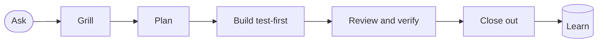

# agent-harness

Skills and small bash tools that make **Claude Code, Codex and OpenCode** work the same way: grill, plan, build test-first, prove it, learn from it. No Node, no Python, no tmux.



## Install
```sh
git clone https://github.com/nchandar/agent-harness ~/agent-harness
~/agent-harness/install.sh
~/.agents/harness/bin/spawn --doctor      # checks your CLIs
```
Needs bash 3.2+, git 2.31+ and one agent CLI. OpenCode v2: run `opencode service start` once. Optional: copy the Routes lines from `AGENTS.md` into your global agent instructions so every project routes automatically.

## Skills
Just ask in plain words; the matching skill runs. Name one to be explicit (`/dev-feature` in Claude Code, or "use dev-debug" in Codex and OpenCode).

| Skill | Say something like | What it does | You get |
|---|---|---|---|
| `dev-feature` | "add rate limiting", "refactor the parser" | grill, spec, thin slices, test first, review, verify, ship | code, tests, a ledger trail |
| `dev-debug` | "login test fails", "crashes on empty input" | repro, root cause, doubt, regression test, fix | a fix and its failing-then-passing test |
| `dev-research` | "compare Redis and Postgres", "how does auth work" | grill, research, checkpoint, report | `report.md` with a build handoff, plus `report.html` for systems |
| `dev-review` | "review my branch" | Standards and Spec scouts in parallel, blast radius | findings with file:line |
| `dev-spawn` | "open a codex instance and run X" | one headless worker per task on claude, codex or opencode | a short handoff with evidence |
| `dev-learn` | "learn from this" | dedupes queued lessons, drafts a library change on a branch | a diff you approve |

Every skill has the same shape: a checklist the agent copies into its task list, with skipped steps kept and explained.



## Where things live
All local and git-ignored: `ledger start` adds `.harness/` to the repo's own exclude file.

| Thing | Where | Kept |
|---|---|---|
| Ledger: what happened and why | `.harness/tasks/<id>/ledger.tsv` | forever, append-only |
| `state.md`: the current picture | same folder | rewritten at checkpoints |
| Briefs, handoffs, logs | same folder | per task |
| `memory.md`: durable project notes | `.harness/memory.md` | per project |
| Learning inbox | `~/.agents/learnings/` | until promoted or dropped |

## Everyday commands
Tools live in `~/.agents/harness/bin/`.

| I want to | Run |
|---|---|
| pick up where I left off | `reconcile` |
| see what is queued to learn | `learn list`, then ask for `dev-learn` |
| run tests without the noise | `run <cmd>` |
| hand a task to another agent | `spawn --prompt "..." <id> codex` |
| check my setup | `spawn --doctor` |

## Settings
Workers skip permission prompts but can never push.

| Variable | Effect |
|---|---|
| `HARNESS_VIEW=off` | no herdr tabs for workers |
| `HARNESS_MODEL` | model name for workers (cheaper runs) |
| `HARNESS_SAFE=1` | restricted worker permissions |
| `HARNESS_TIMEOUT` / `HARNESS_MAX_WORKERS` | kill a hung worker (900 s) / live workers (2) |

[Contributing](CONTRIBUTING.md) · [Animated architecture](docs/architecture.html) (open locally) · MIT, see `LICENSE`

Ideas adapted, not copied, from [addyosmani/agent-skills](https://github.com/addyosmani/agent-skills), [mattpocock/skills](https://github.com/mattpocock/skills) and [cursor/plugins](https://github.com/cursor/plugins). All MIT.
