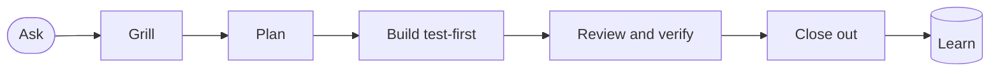

# dev-kit

Skills and small bash tools that make **Claude Code, Codex and OpenCode** work the same way: grill, plan, build test-first, prove it, learn from it. No Node, no Python, no tmux.



## Install
```sh
git clone https://github.com/nchandar/dev-kit ~/dev-kit
~/dev-kit/install.sh
~/.agents/dev-kit/bin/setup              # check first, read-only
~/.agents/dev-kit/bin/setup --apply      # then fix
```
Needs bash 3.2+, git 2.31+, perl and one agent CLI. OpenCode v2: run `opencode service start` once. It gets a `/dev-mode` command, which routes through dev-mode. Optional: copy the Routes lines from `AGENTS.md` into your global agent instructions so every project routes automatically. `bin/setup` checks the environment; `spawn --doctor` checks adapter flags.

## Skills
Ask in plain words and run `/dev-mode`, which picks the playbook. Name one to skip triage (`/dev-feature` in Claude Code, or "use dev-debug" in Codex and OpenCode).

| Skill | Say something like | What it does | You get |
|---|---|---|---|
| `dev-mode` | "/dev-mode fix the login bug and add a remember-me option" | triage by type and size, announce the route, hand off to its playbook, stay on route, one closing answer | the right loops run in order, with a status footer |
| `dev-feature` | "add rate limiting", "add CSV export" | recon, options, spec, thin slices, test first, review, verify, ship | code, tests, a ledger trail |
| `dev-refactor` | "refactor the parser", "split this file, no behavior change" | pin behavior, subtract first, small green steps, prove the output is unchanged | a reshaped codebase and its equivalence proof |
| `dev-debug` | "login test fails", "crashes on empty input" | recon, hypotheses, repro, root cause, doubt, regression test, fix options, fix, review | a fix and its failing-then-passing test |
| `dev-research` | "compare Redis and Postgres", "how does auth work" | grill, research plus external standard pass, checkpoint, report with labeled options | `report.md` with a build handoff, plus `report.html` for systems |
| `dev-review` | "review my branch" | Standards and Spec scouts in parallel, blast radius | findings with file:line |
| `dev-spawn` | "open a codex instance and run X" | one worker per task (interactive herdr tab, headless fallback) on claude, codex or opencode | a short handoff with evidence |
| `dev-eval` | "did that skill change help?" | blind candidate runs, a blind judge, a recommendation | a verdict: promote, drop or rerun |
| `dev-learn` | "learn from this" | dedupes queued lessons, drafts a library change on a branch | a diff you approve |
| `dev-formal-verification-skill` (support skill, not a route) | "should I model this race?" | triage: no model builds one, a drifted model gets maintained, a chart-only request runs TLC and tlachart | the right pass, with the promise and its exclusions |
| `dev-create-formal-verification-skill` (support skill, not a route) | "build a model for this lease" | pick one promise, model it in TLA+, check it with TLC, prove each rule can fail, replay the trace | a counterexample or a pass, a chart, a coverage record and sync commit |
| `dev-maintain-formal-verification-skill` (support skill, not a route) | "did this change stale the model?" | diff covered code from the sync commit, give each change an outcome, update from the code, rerun and break-test | in-sync, updated, bug or blocked, with a new sync commit |

Route skills are playbooks with one shape: You own, Reads (the library files and when), a Checklist the agent opens as a visible todo list and ticks off (skipped steps stay, with a reason), Hand off to, and Reply. They are explicit-only: type `/dev-mode` and it picks one, or type `/dev-debug` and the like directly.



## Where things live
All local and git-ignored: `ledger start` adds `.devkit/` to the repo's own exclude file.

| Thing | Where | Kept |
|---|---|---|
| Ledger: what happened and why | `.devkit/tasks/<id>/ledger.tsv` | forever, append-only |
| `state.md`: the current picture | same folder | rewritten at checkpoints |
| Briefs, handoffs, logs | same folder | per task |
| `memory.md`: durable project notes | `.devkit/memory.md` | per project |
| Learning inbox | `~/.agents/learnings/` | until promoted or dropped |

## Everyday commands
Tools live in `~/.agents/dev-kit/bin/`.

| I want to | Run |
|---|---|
| pick up where I left off | `reconcile` |
| see what is queued to learn | `learn list`, then ask for `dev-learn` |
| wait for my workers before ending a turn | `reconcile --wait` (the Stop hook `stop-gate` blocks until each is accepted; see ARCHITECTURE.md 3.9) |
| run tests without the noise | `run <cmd>` |
| hand a task to another agent | `spawn --prompt "..." <id> codex` |
| check and fix my setup | `setup`, then `setup --apply` |
| render a Mermaid chart | `chart-svg SRC.mmd OUT.svg` |

## Settings
Workers skip permission prompts but can never push.

| Variable | Effect |
|---|---|
| `DEVKIT_VIEW=off` | no herdr tabs for workers |
| `DEVKIT_MODE` | `auto` runs claude, codex and opencode as their interactive TUI in a herdr tab when herdr is up; `headless` forces `-p`; `interactive` fails (exit 2) without herdr |
| `DEVKIT_POLL`, `DEVKIT_GRACE` | seconds between handoff checks in interactive mode (2); seconds a worker may keep writing after its handoff appears (10) |
| `DEVKIT_NUDGE_WAIT` | seconds after launch an interactive worker may go without a task list on screen before spawn re-sends the checklist instruction once (20); 0 disables |
| `DEVKIT_IDLE_WAIT` | seconds an interactive worker may sit idle with no final handoff before spawn nudges it once; idle that long again fails the run; 0 disables |
| `DEVKIT_MODEL` | model name for workers (cheaper runs) |
| `DEVKIT_SAFE=1` | restricted worker permissions |
| `DEVKIT_TIMEOUT`, `DEVKIT_MAX_WORKERS`, `DEVKIT_MAX_LEADS`, `DEVKIT_MAX_DEPTH`, `DEVKIT_CHILD_WAIT`, `DEVKIT_STOP_TIMEOUT` | hung-worker timeout, live workers, live leads, nesting depth, nested slot wait, cap on the opencode session delete; defaults are in the ARCHITECTURE.md env table |

## Under the hood


Every tool, file format, skill and library file is described in [ARCHITECTURE.md](ARCHITECTURE.md).

[Contributing](CONTRIBUTING.md) · [Architecture](ARCHITECTURE.md) · MIT, see `LICENSE`

Ideas adapted, not copied, from [addyosmani/agent-skills](https://github.com/addyosmani/agent-skills), [mattpocock/skills](https://github.com/mattpocock/skills) and [cursor/plugins](https://github.com/cursor/plugins). All MIT.
